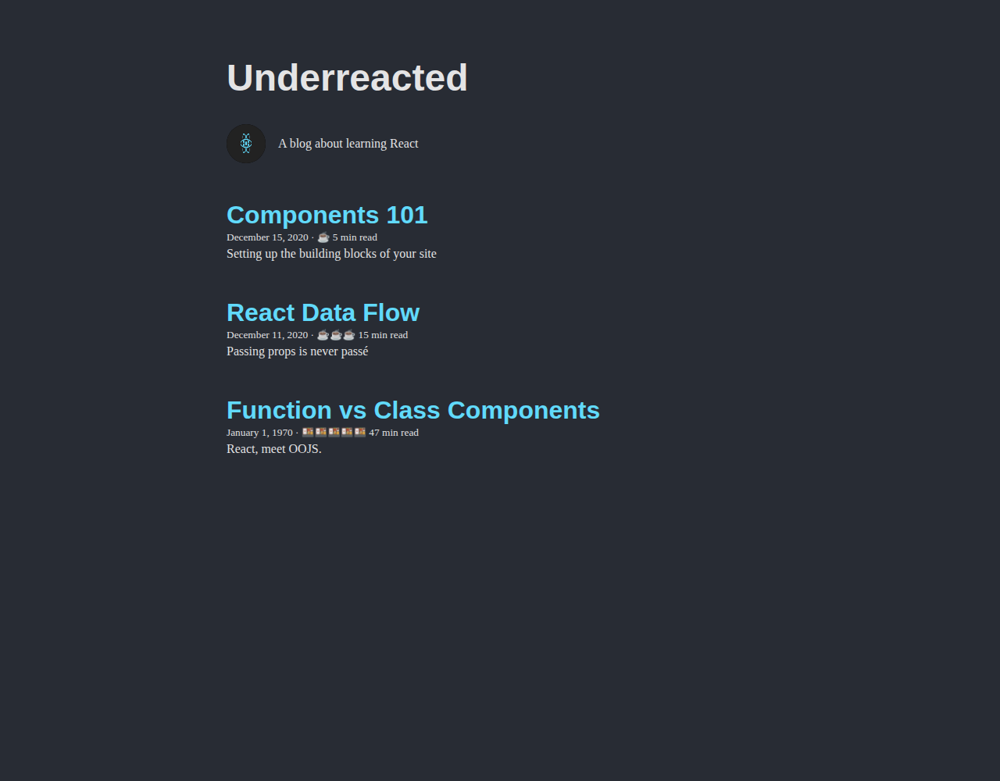

# Underreacted Blog

A static React blog demonstrating component composition and passing data through
props.

## Run the project

1. Install dependencies with `npm install`.
2. Start the development server with `npm run dev`.
3. Open the local URL printed by Vite (usually `http://localhost:5173`).

Useful checks:

- `npm test -- --run` runs the component tests.
- `npm run lint` checks the code with ESLint.
- `npm run build` creates the production build in `dist/`.

## Component structure

```text
App
├── Header
├── About
└── ArticleList
    └── Article (one per post)
```

- `App` imports the blog data and passes the name, image, about text, and posts
  to its children.
- `Header` receives `name` from `App` and renders the blog heading.
- `About` receives `image` and `about` from `App` and renders the blog
  description and accessible logo.
- `ArticleList` receives `posts` from `App` and renders an `Article` for each
  post.
- `Article` receives each post's `title`, `date`, and `preview` from
  `ArticleList`, and displays a coffee or bento-box read-time indicator when
  the post includes a `minutes` value.

## Read-time indicator

Posts under 30 minutes display one coffee cup per 5 minutes (rounded up).
Posts of 30 minutes or more display one bento box per 10 minutes (rounded up).

## Screenshot


